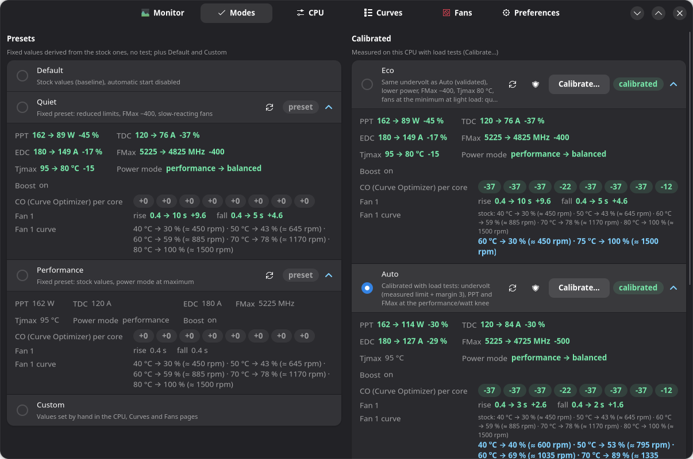
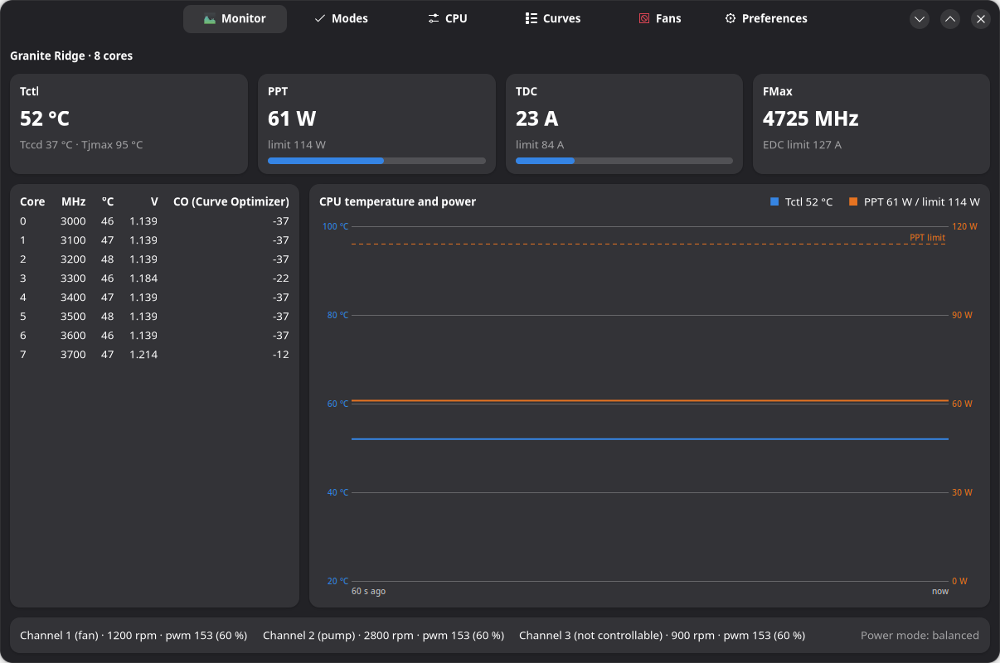
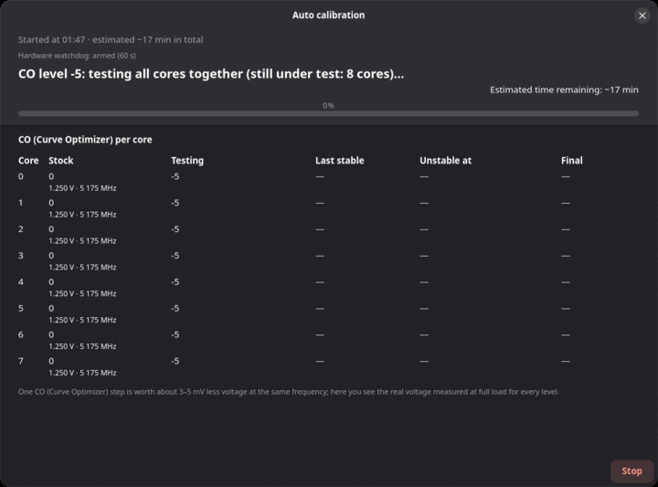
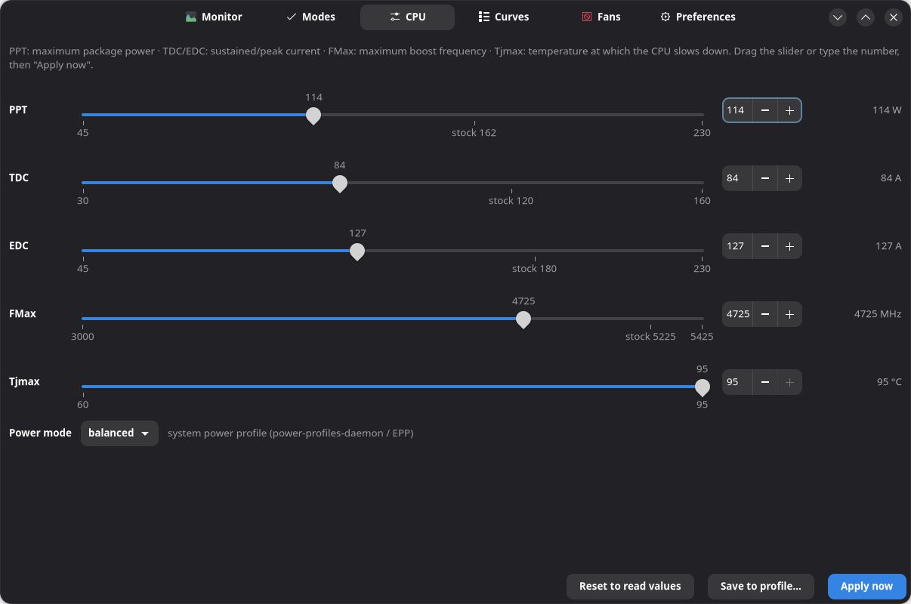
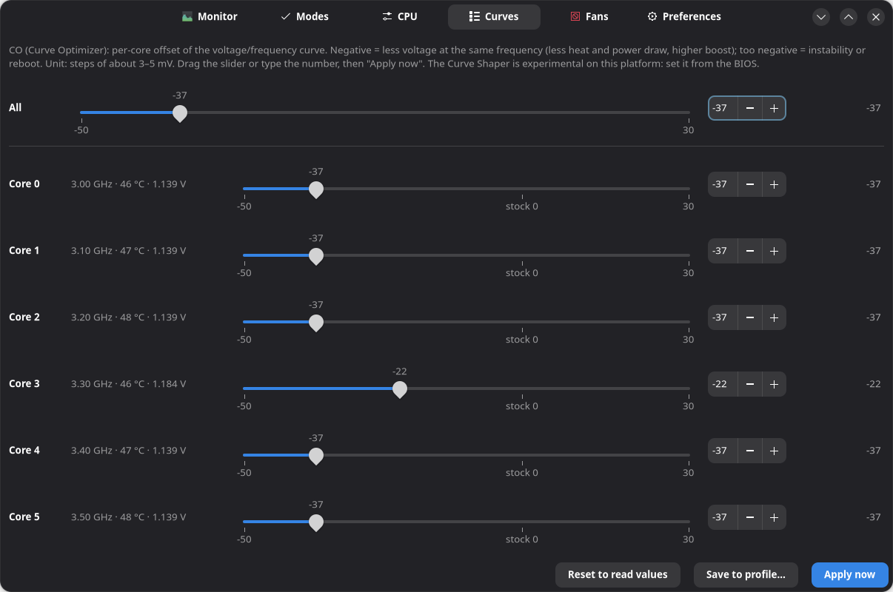
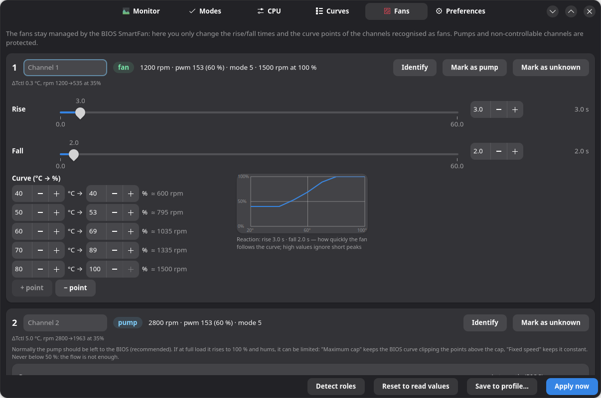
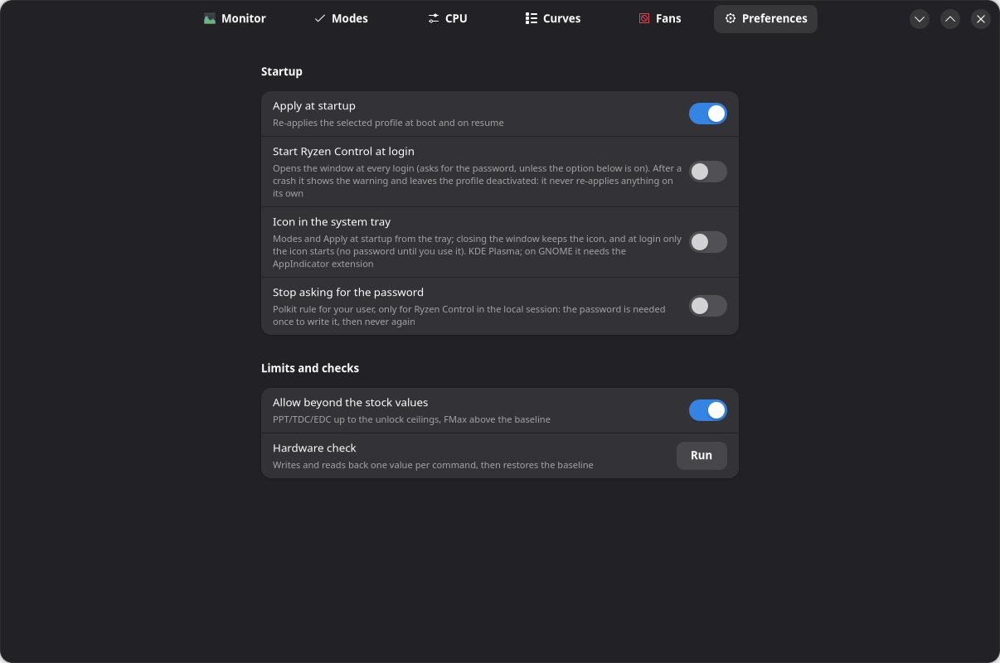

# Ryzen Control

Ryzen Master-style control for AMD Ryzen 9000 (Granite Ridge) on Linux: per-core Curve
Optimizer and Curve Shaper, PPT/TDC/EDC limits, boost frequency (FMax), maximum temperature
(Tjmax), power profile and motherboard fans. Profiles applied at boot with protection after a
crash.

> **Warning.** Experimental software that talks directly to the processor's SMU.
> Developed and tested on a single system: Ryzen 7 9800X3D, ASUS ROG STRIX X870E-H, Fedora 44.
> Any other CPU is refused. A Curve Optimizer that is too negative can reboot the system (no
> damage, but unsaved work is lost): read "Safety" before using it.

Status: phases 1–4 done on the development system — `ryzenctl` helper/CLI, systemd services,
driver via DKMS, RPM package, fans, GTK4 GUI and calibrations. Next: other Ryzen CPUs, tray icon,
deb/Arch packages (see `docs/plans/`).



## Installation

### Fedora (RPM)

```sh
make rpm                                   # requires rpm-build, rpmdevtools, git
sudo dnf install dist/ryzen-control-*.rpm
```

A single package that does everything by itself: it builds the `ryzen_smu` module via DKMS for
every installed kernel (`dkms.service` rebuilds it at every update) and starts the service,
which loads the module and reads the baseline (no profile is applied).

**Secure Boot**: the module must be signed with a key enrolled in MOK. If the akmods key is
already enrolled on the system (typical with RPM Fusion's NVIDIA drivers), DKMS reuses it
automatically: no manual step. Otherwise the package says so at the end of the installation
and a one-time enrollment is needed — it is a Secure Boot limitation (it requires physical
confirmation at reboot), not something software can work around:

```sh
sudo mokutil --import /var/lib/dkms/mok.pub      # asks for a temporary password
sudo reboot                                       # MOK Manager: Enroll MOK → Continue → password
```

Check (all automatic, reversible, a couple of seconds):

```sh
sudo ryzenctl status                        # BIOS values, "Baseline of this boot"
sudo ryzenctl hwtest                        # writes and reads back every command close to the baseline, then restores it
```

### Other distributions

deb and Arch packages are planned (`packaging/`). In the meantime, with `dkms`, the kernel
headers, `python3 >= 3.9`, `polkit` and `systemd` installed:

```sh
sudo make install && sudo make dkms
sudo systemctl enable --now ryzenctl.service ryzenctl-resume.service
```

To remove: `sudo make uninstall`.

## Usage (GUI)

Open **Ryzen Control** from the application menu (or run `ryzen-control`). The first action that
needs root asks for the administrator password once per session; "Stop asking for the password"
in Preferences removes even that one. The screenshots below come from the fake backend
(`make screenshots`), so the values are illustrative.

**Monitor** — the CPU family and its active cores on top (with a note when the family has not
been verified on hardware yet), Tctl and per-core temperature, PPT and TDC against their limits,
MHz, voltage and Curve Optimizer per core, a 60 s graph of Tctl (blue, °C) and PPT (orange, W, its
limit dashed), fan speeds and power mode. Every per-core view lists only the active cores.



**Modes** — one click switches between stock values (Default), the fixed presets (Quiet,
Performance), the modes calibrated on this CPU (Eco, Auto, Boost) and your own values (Custom).
Every profile lists its values, fans included: green is more conservative than stock, red more
aggressive, grey unchanged. Boost needs "Allow beyond the stock values" (Preferences): until then
it is shown dimmed, and hovering it says why.

**Calibration** — "Calibrate…" on Auto or Boost measures this CPU: the Curve Optimizer limit of
every core under load, a final pass on all cores, then the performance/watt knee (Auto) or the
gain over stock (Boost), with the remaining time and the real voltage measured per core. Eco
reuses the undervolt that Auto or Boost validated, so it is usually ready at once. At the end you
choose: discard, save, or save and apply. Save your work first: an unstable level can reboot the
PC (see "Safety").



**CPU** and **Curves** — the same values by hand: PPT/TDC/EDC, FMax, Tjmax and power mode, then
the Curve Optimizer for all cores or one by one. "Apply now" writes them (each value is read
back), "Save to profile…" keeps them.





**Fans** — the BIOS SmartFan stays in charge: you only change how fast each fan follows its
curve (rise/fall) and the curve points, with the estimated rpm. Pumps and non-controllable
channels are protected; the pump can only be left to the BIOS (recommended), capped, or set to a
fixed speed (never below 50 %). Channels with an unknown role are grouped in a collapsed
"Unknown channels" section at the end of the page (listed in Monitor only while it is open); its
state is remembered.



**Preferences** — "Apply at startup" re-applies the selected profile at every boot and resume,
never after a crash; "Start Ryzen Control at login" opens the window at every login; "Stop asking
for the password" writes the polkit rule described in "Safety"; "Allow beyond the stock values"
raises the PPT/TDC/EDC and FMax ceilings (unlock); "Hardware check" writes and reads back one
value per command, then restores the baseline.



## Usage (CLI)

All commands share the same grammar on the CLI, in profile files and in the GUI. A profile is
the stock state (the baseline captured at boot) with its own lines on top: whatever it does not set
— a fan curve, a limit — is applied and shown at its stock value, so switching mode never leaves
the previous mode's fans or limits behind. The pump is never part of a mode.

```sh
sudo ryzenctl status                 # current state and baseline
sudo ryzenctl co 7 -15               # Curve Optimizer of core 7; `co all -10`; `co v0 … v7`
sudo ryzenctl ppt 120                # limits: ppt (W), tdc (A), edc (A)
sudo ryzenctl fmax 5000              # maximum boost frequency (MHz)
sudo ryzenctl tjmax 85               # maximum temperature (°C), never above the baseline
sudo ryzenctl power balanced         # power-saver | balanced | performance
sudo ryzenctl default                # everything back to the base (BIOS) values, autostart off
sudo ryzenctl trust on|off|status    # polkit rule: your user starts Ryzen Control without a password
sudo ryzenctl hwtest                 # reversible test of every command with readback
```

Profiles (`/etc/ryzenctl/profiles/<name>.conf`, one line per command, `#` comments):

```sh
sudo ryzenctl profile save quiet "co all -15" "ppt 88" "tdc 75" "edc 150" "fmax 4800" "power balanced"
sudo ryzenctl apply quiet            # apply now
sudo ryzenctl use quiet && sudo ryzenctl autostart on     # apply at every boot and after resume
sudo ryzenctl profile list | show quiet | delete quiet
```

Beyond the factory values (PPT up to 230 W, TDC 160 A, EDC 230 A, FMax +200 MHz) only after
`sudo ryzenctl unlock on`, which prints a warning. Tjmax never exceeds the baseline.

### Fans (motherboard, Nuvoton nct67xx chip)

```sh
sudo ryzenctl fan enable             # loads nct6775 and makes it permanent; if the chip does not show up because of an
                                     # ACPI conflict it adds acpi_enforce_resources=lax (grubby) and asks for a reboot
sudo ryzenctl fan status             # channels, rpm, pwm, step, curve, role
sudo ryzenctl fan autodetect         # ~30 s per channel under load: assigns the roles ventola (fan) / pompa (pump) / non-controllabile
sudo ryzenctl fan 1 step 10000 5000  # SmartFan reaction delay (ms, ramp up/ramp down): ignores short spikes
sudo ryzenctl fan 1 curve 40:77 60:150 75:255   # temperature:pwm points (pwm >= 51, last one 255 within 125 °C)
sudo ryzenctl fan 2 pump max 70      # pump: BIOS curve capped at 70 %; `pump 65` = fixed; `pump auto` = BIOS
sudo ryzenctl fan identify 2         # 100 % for 5 s to physically recognise the channel
sudo ryzenctl fan name 1 "top radiator"; sudo ryzenctl fan role 3 pompa   # by hand you can only demote
sudo ryzenctl fan disable
```

Writes go only to channels classified **ventola** (fan) by `fan autodetect` (physical test:
channel at 40 % for 20 s under load; the pump raises Tctl by degrees in seconds, a fan does
not); the pump and the channels that do not respond to PWM stay read-only. The only exception,
at the user's choice, is for the pump: **maximum cap** (`fan N pump max 70`: BIOS curve with
the points above the cap reduced, minimum 50 %) or fixed speed (`fan N pump 65`), because the
BIOS curve drives it to 100 % under sustained load and it hums; `fan N pump auto` restores the
BIOS. In profiles: `fan <N> step …`, `fan <N> curve …`, `fan <N> pump auto|max <pct>|<pct>`.

### Modes and automatic calibration

From the GUI (Modes page) or the CLI. Fixed presets (no test): **Default** = BIOS values,
**Quiet** = limits ×0.55/0.63/0.83, FMax −400, Tjmax 80, fans 10 s/5 s, **Performance** =
factory values with power at maximum. Modes **calibrated on the hardware** with load tests
(**Eco**, **Auto**, **Boost**): the search for the per-core CO stability limit is a single one,
shared and saved (`/var/lib/ryzenctl/co_limits.json`, reused by later calibrations), and the three
modes use the same margin (+3), so the same validated undervolt.

```sh
sudo ryzenctl preset quiet|performance|eco|auto|boost   # creates the profile from the factory values (placeholder)
sudo ryzenctl autotune estimate eco              # estimated duration (0 s when Eco reuses a validated final pass: eco_from)
sudo ryzenctl autotune start eco|auto|boost [target=70 colimit=-40 margin=3 step=90 parallel=1 reuse=1 fans=0|1|2]
sudo ryzenctl autotune step                      # one test at a time; repeat until phase == done
sudo ryzenctl autotune status | abort            # abort stops immediately, even a step in progress
sudo ryzenctl autotune save [apply]              # at phase == done: writes the proposed profile (and applies it); abort discards it
```

When the calibration is over the CPU goes back to the factory values and the profile is only
**proposed**: you choose whether to cancel, save (the profile appears in Modes, not active) or
save and apply. Without a choice the state stays on disk and the GUI offers it again at the
next start.

From the GUI: Modes → "Calibrate…" on Eco, Auto or Boost, then "Automatic" (default values) or
"Choose the values…"; at the end the buttons **Cancel / Save / Save and apply**. In both cases you choose how much the
mode touches the fans (`fans`), only on the channels recognised as fans: 0 BIOS untouched;
1 moderate (Auto and Boost default): rise 3 s / fall 2 s and the BIOS curve raised by 10 % with
full speed at 100 °C — the BIOS curves reach 100 % only at 125 °C, so under load the fans hardly
react; 2 quiet (Eco default): 10 s / 5 s, BIOS minimum up to `target` −10 °C, 100 % at Tjmax −5 °C
(`target` only shapes this curve).
The curve always starts from the BIOS one captured at boot, so a recalibration never raises it twice.
By default the
cores are tested **all together** at every CO level (one worker per core, ~8× faster;
`parallel=0` = one core at a time, which attributes even a reboot with certainty). During the
tests the GUI shows the estimated remaining time, the real voltage measured per core at every
level and how many mV one CO step is worth on this CPU.

- **Auto**: searches for the stable negative Curve Optimizer (steps of −5 down to `colimit`,
  load phases: the heaviest method, mixed methods with verify, 50 %, single bursts for the
  maximum boost; MCE error check), CO = last stable + 3, final pass on all cores, then the
  performance/watt knee: sweep of PPT (multi-thread) and FMax (single-thread) measuring
  stress-ng bogo-ops/s and RAPL power, choosing the lowest value that loses at most `loss` %
  (default 10) against the maximum.
- **Eco**: the same validated undervolt with the Eco preset values: limits ×0.55/0.63/0.83
  (≈ AMD 65 W class), FMax −400, Tjmax 80, balanced power, quiet fans — quiet under heavy load.
  Every successful final pass is recorded in `co_limits.json` (`final_passed`): if one covers
  Eco's CO, Eco is proposed at once with no load test; with only the per-core limits it runs the
  final pass; on a fresh install (no measurement yet) the full search and the final pass.
- **Boost** (needs `ryzenctl unlock on`, "Allow beyond the stock values" in the GUI): CO =
  limit + 3, limits at the unlock ceilings (230 W / 160 A / 230 A) and FMax +200 MHz, power at
  maximum; measures the MT/ST gain against stock. Without the unlock ryzenctl refuses `preset`,
  `autotune start`, `use` and `apply` for boost, and `unlock off` is refused while Boost is the
  selected mode (switch mode first).

The CO search uses as the first phase of every level the heaviest stress-ng method on this CPU
(probed at start with factory CO); measurements from earlier versions, taken without this load,
are not reused. The **final pass** (all cores at the proposed CO) starts with the stress-ng
method that draws the most power on this CPU, at full load for 60 s with verify, then 100 s
full / 50 % / 10 %. If it fails, or if in a later phase (knee, benchmark) a load dies, an
MCE error appears or the system freezes and is rebooted, the combination is unstable: +3 on all
cores and the final pass repeated (3 attempts at most). If the search itself ends with a system
freeze, the margin gets an extra +3: the "stable" level below the crash one was tested only for
`step` seconds. Failed combinations stay in `co_limits.json` and later calibrations do not
retry them. After a forced reboot the interrupted step is marked unstable as soon as
`ryzenctl.service` starts, before any choice in the GUI (Resume or Cancel). Result on the
development 9800X3D: with the heaviest method in the search the per-core limit is −35 (−40 froze
the system), and the final pass at −29 on all cores is stable; one CO step is worth ≈ 3.4 mV.

**Warning**: an unstable CO can reboot the PC during the calibration (no damage, unsaved work
lost). The state is on disk: at reboot the interrupted step is marked unstable and the
calibration resumes. Duration from scratch ~25–40 min (search and final pass, plus the knee or the
bench); with the limits already measured ~7 min plus the knee or the bench; Eco covered by a
recorded pass: immediate. An Eco calibration left halfway by a version before 0.4.4 (phase
`fmax`) cannot be resumed: discard it.

**Curve Shaper**: experimental and effectively disabled. On the 9800X3D with SMU 98.81.0 the
write command (RSMU 0xA6) answers OK but the read command (0x84) returns only zeros or the
argument itself, so no write can be verified: `shaper` stays out of profiles and baseline
(`shaper raw` / `shaper probe` are only for investigation). The Curve Shaper has to be set from
the BIOS.

## Safety

- No voltage command, ever: no SoC/VDDIO/VDDG, no fixed VID, no OC mode, no PBO scalar, no SMN
  writes. Only the allowlisted IDs are sent (CO, limits, FMax, Tjmax, Shaper, reads) and every
  value is a *limit* that the firmware keeps enforcing.
- The **baseline** (BIOS values) is read at every boot before any change and is the ceiling of
  every value. Without a baseline of this boot no CPU write is accepted.
- Every write is verified by reading the value back; if it does not match, one retry, then
  restore of the base value and error.
- The Curve Optimizer addresses a core by its physical position in the CCD, while Linux lists
  only the enabled cores. With complete CCDs (8 cores) the positions are 0–7 in order. With
  disabled cores (e.g. 9600X, 9900X, 7600X) the positions come from the core fuses, read through
  the driver's `smn` file — reads only, only at the fuse addresses of the CPU family — and are used
  only if they agree with the system topology; otherwise the per-core CO is refused.
- **Crash-guard**: `ryzenctl.service` writes the markers `dirty` (boot in progress) and `active`
  (state modified) *before* touching the SMU and removes `dirty` at clean shutdown. If both
  exist at the next boot, the system crashed: the CPU profile is **not reapplied**,
  `/var/lib/ryzenctl/crashed` is written, a notification arrives at login (one click opens
  Ryzen Control) and you decide (`ryzenctl crashed clear` + `autostart on` to reactivate, or stay on the BIOS values).
  The "Start Ryzen Control at login" switch (Preferences) only adds a user XDG autostart entry
  (`~/.config/autostart/`): the window opens at login with the pkexec prompt and, after a
  crash, shows the warning with Reactivate / Stay on Default. Reapplying at boot remains the
  exclusive job of `ryzenctl.service` (`autostart` ∧ no crash): the GUI applies nothing.
  "Stop asking for the password" (Preferences, `ryzenctl trust on`) writes
  `/etc/polkit-1/rules.d/50-ryzen-control.rules`: your user, in the active local session,
  starts `pkexec ryzenctl serve` without authenticating. It applies only to this action, it is
  not a generic sudo; in exchange every program run as your user can change limits, CO and fans
  (within ryzenctl's ceilings). `trust off` removes the rule.
- Total escape hatch: at boot, in GRUB, press `e` and add `ryzenctl.off` to the kernel line:
  the service does not start and the module is not loaded (it is blacklisted, only the service
  loads it).
- Everything is volatile: a reboot returns to the BIOS values.

## Hardware verification (phase 1 checklist)

1. `dkms status` installed; `modinfo -F signer ryzen_smu` (akmods key or enrolled DKMS key);
   `systemctl status ryzenctl` active; `cat /sys/kernel/ryzen_smu_drv/codename` = 23.
2. `sudo ryzenctl status` = BIOS values; `sudo ryzenctl hwtest` with result `ok` (every command
   written, read back and brought back to the baseline). Result on the 9800X3D / SMU 98.81.0:
   CO, FMax, PPT, TDC, EDC, Tjmax ok; Curve Shaper not verifiable (see above).
3. Crash-guard: harmless profile (`ppt 150`) with autostart; `sync; echo b | sudo tee
   /proc/sysrq-trigger` → at boot `ryzenctl crashed` populated, `status` = baseline,
   notification at login; `systemctl restart ryzenctl` → baseline unchanged; clean reboot →
   profile applied; suspend/resume → profile still applied; boot with `ryzenctl.off` →
   module not loaded.

## Development

```sh
make check          # selftest (fake backend), layout, systemd units, desktop, metainfo
make driver-check   # builds the driver in a temporary copy (kbuild does not accept spaces in the path)
make rpm            # tarball from HEAD + RPM in dist/
make screenshots    # README screenshots: the GUI on a fresh fake backend (needs a display)
RYZENCTL_ROOT=/tmp/fake python3 ryzenctl boot   # CLI on the fake backend, no root
```

Plan, architecture and work status: `docs/plans/2026-10-09-ryzen-control.md`.

## Language

The UI follows the system locale (gettext), Italian included. To add a translation, create
`po/<domain>/<lang>.po` for the domains `ryzenctl` (helper/CLI) and `ryzen-control` (GUI);
the catalogs are compiled at install by `make`.

## License

GPL-3.0-or-later. The vendored driver in `ryzen_smu/` stays GPL-2.0 (included in the same
package, RPM license `GPL-3.0-or-later AND GPL-2.0-only`); see `ryzen_smu/UPSTREAM.md`.
Technical references: ryzen_smu (amkillam), ZenStates-Core (irusanov), gnr-smu (Kyworn,
measurements on the 9800X3D).
